import primera from "./blender-mcp/02-primera-version.png";
import final from "./blender-mcp/04-render-final.webp";

El 16 de octubre hicimos la primera actividad de la comunidad: una sesión práctica de tres horas para explorar cómo modelar un personaje en 3D con Claude Code y el MCP oficial de Blender. Probamos cuatro formas distintas de abordarlo. Dos salieron muy bien, una regular y una nos hizo reír. Esto es lo que hicimos y lo que aprendimos.

## Por qué lo hicimos

[Antonio](https://bunnyrecords.dev/es), uno de los fundadores, había modelado en 3D con Blender y su MCP una mascota para usarla como marca de su portafolio personal. Ese trabajo ya tenía el recorrido hecho: una skill propia que guía a Claude paso a paso y mucha experiencia ajustando el flujo. Vimos ahí una buena oportunidad de aprendizaje para la comunidad: en lugar de contarlo, repetirlo en vivo y probar distintas formas de abordarlo.

## El stack

- Claude Code como agente.
- El [MCP oficial de Blender](https://www.blender.org/lab/mcp-server/), conectado a Claude Code.
- Una skill de Antonio que organiza el trabajo en fases.
- [Higgsfield](https://higgsfield.ai), con Nano Banana 2.1, para generar imágenes de referencia en uno de los intentos.

## Enfoque 1: una sola imagen de referencia y la skill

El primer experimento fue el más simple: una única imagen de referencia, sin material adicional, y la skill de Antonio.

La referencia fue la foto de un pequeño primate con traje marrón y corbata lila.

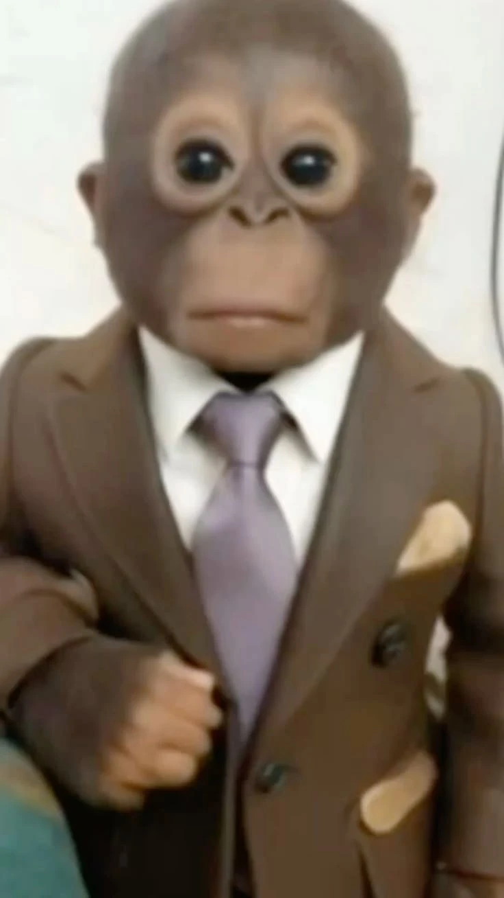

La skill no genera el modelo de un golpe. Lo construye por partes:

1. **Blockout** del cuerpo: las formas básicas y las proporciones.
2. **Detallado**: cara, traje, corbata, botones y zapatos.
3. **Vistas de control**: frente, costado y espalda, para comprobar que el modelo se sostiene desde todos los ángulos.
4. **Renders de poses**: el personaje de pie, con los brazos abiertos, saludando y otras.

La primera versión que salió era correcta pero insulsa: las proporciones estaban, pero le faltaba carácter. Con unas pocas iteraciones de prompts sobre esa base (qué ajustar de la cabeza, la cara y el traje), el resultado mejoró mucho. Desliza para comparar:

<BeforeAfter
    before={primera}
    after={final}
    beforeAlt="Primera versión del modelo 3D del primate: cuerpo y traje correctos, pero con una expresión sosa."
    afterAlt="Render final del modelo 3D del primate, con cara expresiva, traje marrón y corbata lila."
    beforeLabel={{ es: "Primera versión", en: "First version" }}
    afterLabel={{ es: "Tras iterar", en: "After iterating" }}
/>

El flujo cerró con un render limpio de frente y un collage con las poses.

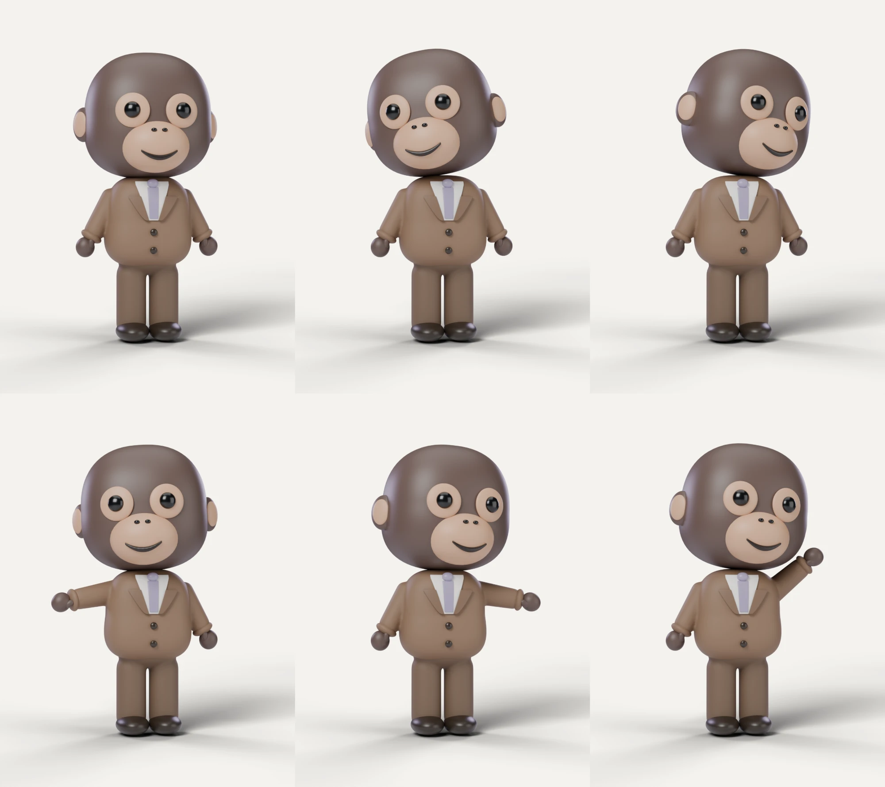

**Tiempo:** el resultado estuvo en unos 30 minutos. Lo que más tomó fue la configuración previa (conectar el MCP y preparar la skill), no la iteración.

## Enfoque 2: replicarlo con el logo de la comunidad, de un solo intento

Con el primer enfoque funcionando, quisimos ver si el mismo mecanismo servía para algo más difícil: el logo de la comunidad, la mascota de café que ves en este sitio. Es un dibujo plano y vectorial, con pelo en picos y mucho detalle, lo contrario del personaje redondeado del primer experimento.

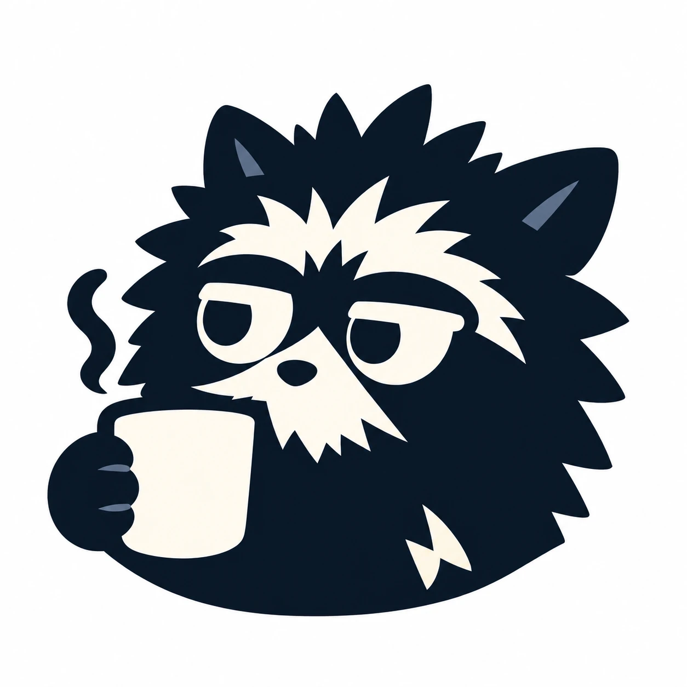

Esta vez cambiamos dos cosas:

- **Ajustamos la skill** para que contemplara un modelado más irregular, con picos y más detalles.
- **No iteramos paso por paso.** Hicimos un solo intento, «un solo disparo» (_one shot_), con muy pocas correcciones después.

El resultado no quedó bien, pero fue instructivo. El modelo tomó el camino más fácil: construyó un cuerpo en forma de globo, le puso algunos picos y **pegó la imagen del logo encima** como si fuera una calcomanía, en lugar de modelar la cara, las cejas y el pelo. De frente se parece al logo, pero al girar se nota que es una superficie hinchada con un dibujo.

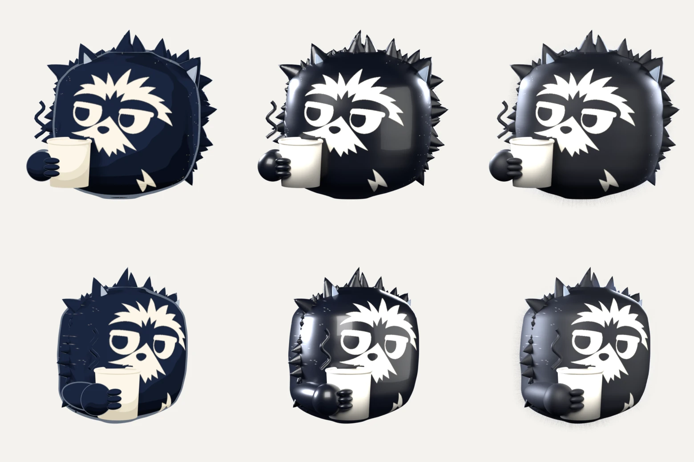

No sabemos con certeza por qué salió así. Nuestras sospechas: la skill se pensó para formas suaves y no para un dibujo con picos, y sin iteraciones intermedias el modelo no tuvo ocasión de corregir el rumbo. Lo que sí quedó claro es que, cuando la referencia es muy plana, el modelo tiende a «pintar» en vez de modelar.

**Tiempo:** otros 30 minutos aproximadamente, con una iteración muy corta.

## Enfoque 3: referencias generadas con IA y modelado paso por paso

En el tercer intento sumamos otra herramienta de IA: generamos la referencia con Higgsfield, usando Nano Banana 2.1 con razonamiento alto y resolución 2K. Cada generación consumió entre 2 y 3 créditos. Así, en lugar de una sola imagen, el modelo de Blender tendría al personaje visto desde el frente, de tres cuartos, de perfil y de espaldas.

La hoja de referencia convertía el logo en un personaje 3D de cuerpo completo: pelaje en picos, cejas claras, hocico con barba, cola anillada.

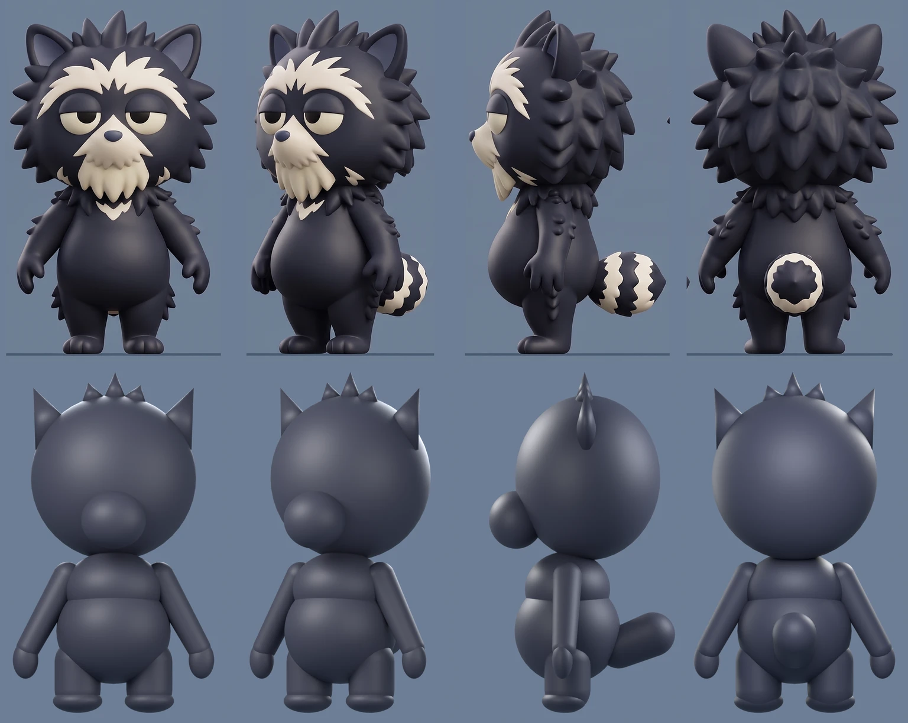

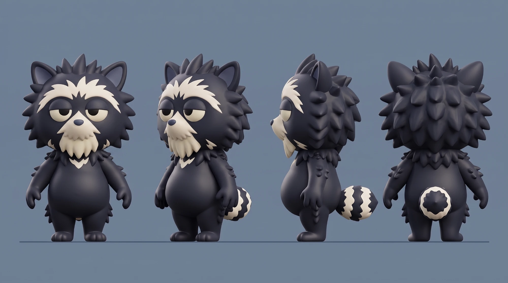

Una autocrítica antes de seguir: el personaje que propusimos era demasiado complejo. Fue un error nuestro no mantenerlo más simple, y buena parte de lo que salió después viene de ahí.

Esta vez sí iteramos paso por paso:

1. Un **blockout** con varios detalles desde el inicio, que fuimos afinando. No mostramos todos los pasos intermedios para no alargar la entrada.
2. La **cara** empezó a tomar forma, con unas mejillas algo cachetonas. En ese punto no teníamos mucha fe en que fuera a parecerse a la referencia.
3. Cuando la superficie ya estaba clara, le dimos **libertad** a la skill para continuar sola hasta terminar.

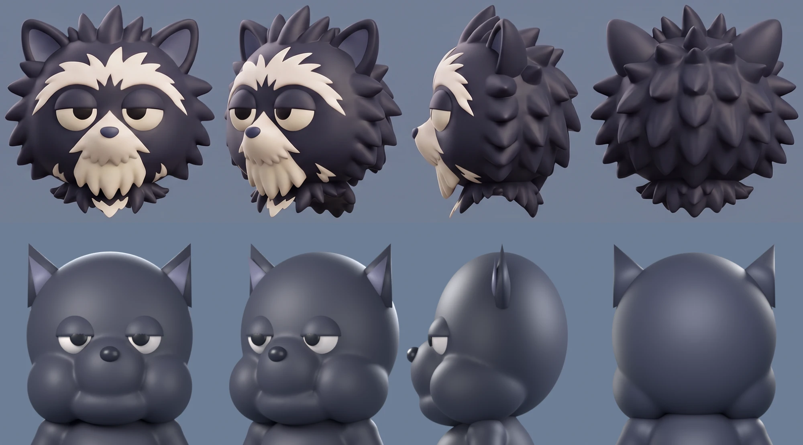

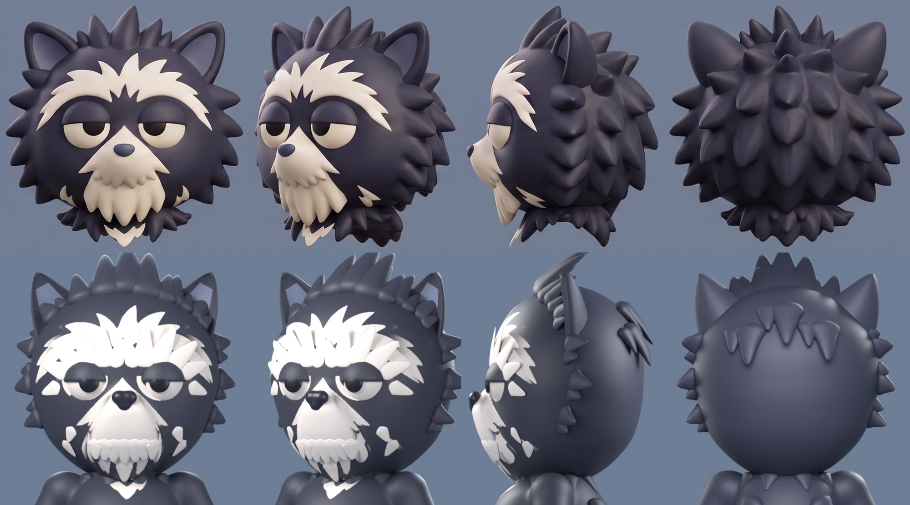

El resultado final tiene los picos de la cabeza y las orejas, pero los mechones blancos de la cara quedaron como piezas sueltas sobre la superficie, y no se parece tanto a la referencia como esperábamos. La estructura, eso sí, quedó bien.

Lo que aprendimos de este intento:

- **El criterio para avanzar era demasiado bajo.** La skill solo pedía un 85 % de similitud con la referencia para pasar al siguiente paso, y con ese margen se le escapaban detalles. Subir el umbral habría hecho que fuera más exigente. Es posible, además, que la forma de medir el parecido tampoco fuera la adecuada.
- **La referencia era demasiado compleja de modelar.** Con un personaje más simple, la misma skill habría tenido un objetivo alcanzable.

**Tiempo:** entre una y dos horas, repartidas en pausas. Buena parte se fue en diseñar el prompt para generar las referencias de los distintos ángulos. No lo medimos de corrido, y esa es una de las ventajas de trabajar así: se puede dejar y retomar.

## Enfoque 4: referencia simplificada y control paso a paso

La última prueba fue la que mejor salió. Antonio, que ya tenía más experiencia con este proceso, partió de una referencia más detallada pero también **más simple** que la del intento anterior. Además de la vista de frente, le pasó a la skill vistas específicas: la cola, la espalda y la cabeza sola.

Volvimos a la skill original, con un control mucho más pausado. Cada fase se revisó antes de pasar a la siguiente.

El resultado es un modelo limpio, con las proporciones y los detalles de la referencia, que se sostiene desde cualquier ángulo y funciona en varias poses.

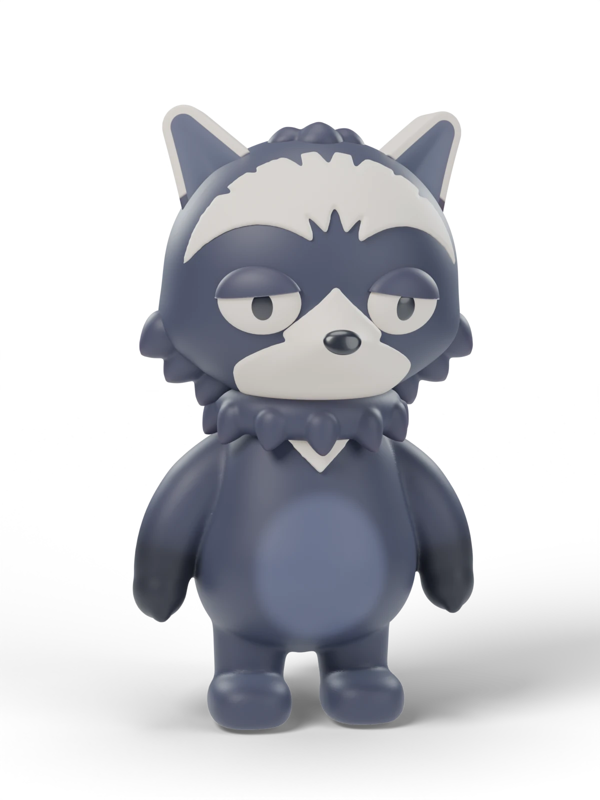

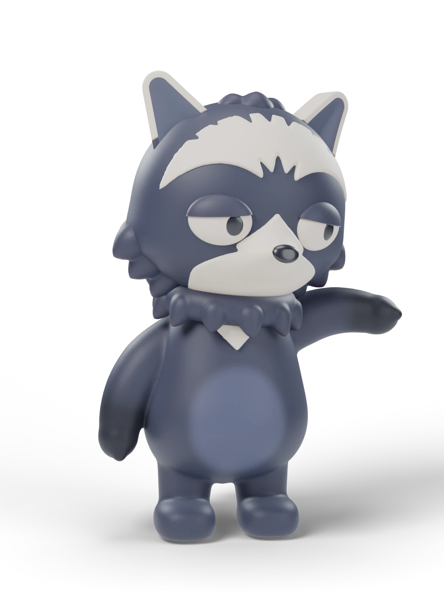

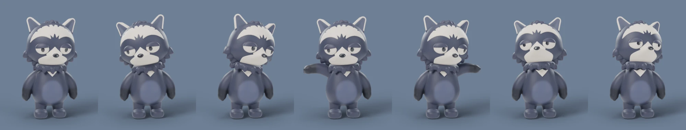

**Tiempo:** como mínimo entre dos y tres horas, quizá algo más, también en varias sesiones y no de una sola corrida. Fue el enfoque que más tiempo llevó.

## Resultados

De los cuatro intentos, dos dieron un resultado que se puede usar (el 1 y el 4), uno quedó a medias (el 3) y uno falló de forma instructiva (el 2).

El modelo terminado (el mapache de la comunidad), con su escena de Blender, los scripts de construcción y los renders, está publicado en el repositorio [blender-pet](https://github.com/Chamba-Lab/blender-pet).

## Comparativa de enfoques

| Enfoque                        | Insumos                                                             | Cómo se trabajó                                         | Tiempo aproximado                                                          | Resultado                                                         |
| ------------------------------ | ------------------------------------------------------------------- | ------------------------------------------------------- | -------------------------------------------------------------------------- | ----------------------------------------------------------------- |
| 1. Una foto y la skill         | Una imagen de referencia                                            | Skill por fases y pocas iteraciones de prompts          | 30 min (la configuración pesó más que la iteración)                        | Muy bueno: personaje pulido, renders y poses                      |
| 2. El logo, de un solo intento | El logo plano                                                       | Skill ajustada, un solo disparo                         | 30 min                                                                     | Flojo: un globo con la imagen pegada encima                       |
| 3. Referencia generada con IA  | Hoja de referencia de Higgsfield, personaje complejo                | Paso a paso y, al final, la skill sola                  | 1 a 2 h, entre pausas (gran parte, diseñando el prompt de las referencias) | A medias: buena estructura, picos y orejas bien, mechones sueltos |
| 4. Referencia simplificada     | Referencia detallada y simple, con vistas de cola, espalda y cabeza | Skill original, control pausado, con experiencia previa | 2 a 3 h o más, en varias sesiones                                          | Muy bueno: limpio y con varias poses                              |

Los tiempos son estimaciones, porque no los medimos de corrido.

## Aprendizajes

1. **Una referencia simple vale más que una espectacular.** El enfoque 3 falló en parte porque el personaje era demasiado complejo, y el 4 salió bien con una referencia más simple.
2. **Varias vistas ayudan.** Pasarle a la skill la cola, la espalda y la cabeza por separado dio un resultado mucho mejor que una sola imagen frontal.
3. **Más control da mejor resultado.** El enfoque de un solo disparo (2) y el de la skill sola al final (3) quedaron por debajo del trabajo paso por paso (1 y 4), aunque lleve más tiempo.
4. **Un umbral de parecido bajo hace pasar por bueno lo que no lo es.** Si la skill se autoevalúa, el criterio tiene que ser exigente, y conviene revisar también cómo se mide ese parecido.
5. **Con una referencia plana, el modelo pinta en vez de modelar.** Lo vimos con el logo del enfoque 2.
6. **La experiencia con la skill se nota.** El mejor resultado vino de quien más la había usado.
7. **La configuración pesa más que la iteración.** En el primer enfoque, el resultado salió en unos 30 minutos, pero preparar el MCP y la skill llevó más.
8. **No hace falta hacerlo de corrido.** Se puede dejar y retomar entre pausas.

## Enlaces

{/* PENDIENTE: la skill de Antonio (cuando esté publicada), como primera línea de esta lista. */}

- [blender-pet](https://github.com/Chamba-Lab/blender-pet): el modelo terminado, los scripts y los renders.
- [Portafolio de Antonio](https://bunnyrecords.dev/es).
- [MCP oficial de Blender](https://www.blender.org/lab/mcp-server/), de Blender Lab.
- [Higgsfield](https://higgsfield.ai).
