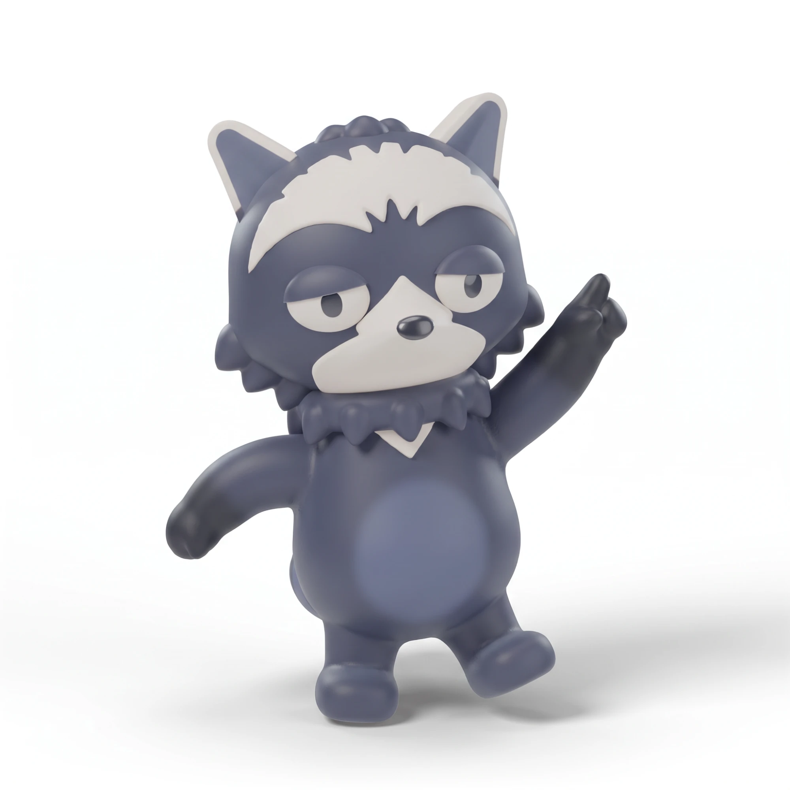
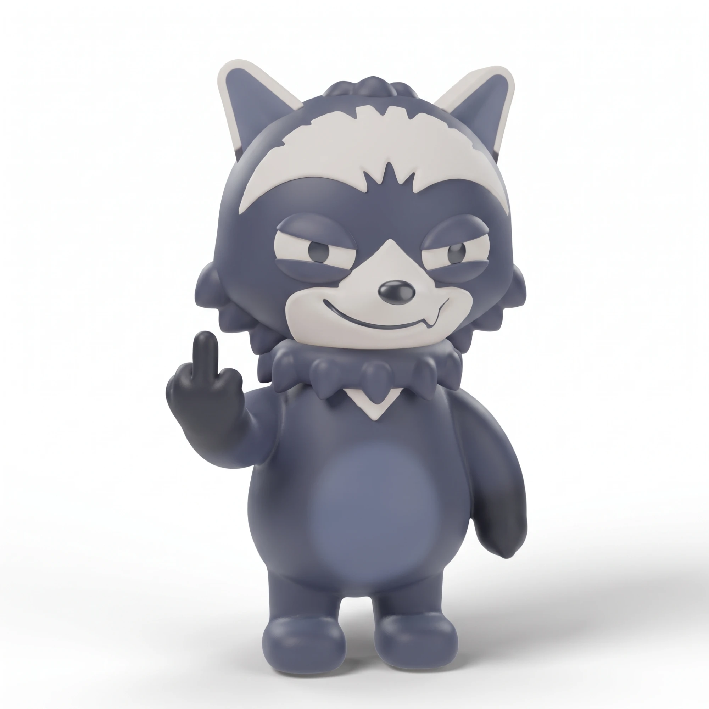

El día después de la sesión de Blender todavía nos quedaban créditos del plan de prueba de Higgsfield, y se iban a vencer en tres días. Así que los aprovechamos: del 17 al 19 de octubre generamos imágenes y video de nuestra mascota para ver qué ofrece la plataforma. No hubo hora fija: lo fui iterando durante el día, entre descansos y por el chat del equipo. Lo conduje yo, porque la cuenta con los créditos era la mía. Después, otras personas del equipo sacaron su propia cuenta gratuita y la usaron con sus ideas.

## Herramientas utilizadas

- [Higgsfield](https://higgsfield.ai): la plataforma de generación. Usamos Nano Banana 2.1 y Seedream 5.0 Pro para imágenes, Seedance 2.5 para video desde imágenes y Genjutsu (Motion Transfer) para video a partir de plantillas.
- [Claude Code](https://claude.com/product/claude-code) con el MCP de Higgsfield: con el plan de prueba solo pudimos consultar (saldo, historial y transacciones), no generar. Los números de esta entrada salen de ahí.

Usamos el **plan de prueba**: 100 créditos durante 3 días y una generación de video gratis. Las condiciones pueden cambiar.

## Qué probamos

**Imágenes.** Con la hoja de referencia de la mascota generamos escenas y poses nuevas con Nano Banana 2.1, variando el formato y la calidad, y comparamos con una generación de Seedream 5.0 Pro.

Y como una comunidad también se ríe, probamos un tono más pícaro: la mascota salió con su sonrisa torcida y un gesto que no se enseña en las entrevistas.

**Video desde imágenes.** Con Seedance 2.5 le dimos las cuatro vistas de la mascota y le pedimos un saludo y un gesto de «pasa, pasa». Salieron 6 segundos, en vertical y a 720p.

<Clip
    src="/blog/higgsfield/saludo-seedance.mp4"
    title="Seedance 2.5: la mascota saluda y hace un gesto de invitación (6 s, sin sonido)."
/>

**Video con una plantilla.** Genjutsu es el modelo de Higgsfield para esto: parte de plantillas de reels y de tendencias virales que puedes personalizar con tu propio personaje. En Motion Transfer le damos un video de referencia y reemplaza a la persona por nuestra mascota, sin animar nada a mano.

<Clip
    src="/blog/higgsfield/plantilla-motion-transfer.mp4"
    title="Motion Transfer: la mascota reemplaza a la persona de un video de referencia (7 s, 480p)."
/>

La generación gratis del plan fue otra plantilla, en vertical y de 15 segundos, con la mascota jugando al fútbol en un estadio. Aquí la mostramos recortada a los primeros 8 segundos y sin el audio original.

<Clip
    src="/blog/higgsfield/futbol-genjutsu.mp4"
    title="Genjutsu: la mascota reemplaza a un jugador en un video de fútbol (8 de 15 s, sin audio)."
/>

## Cuánto costó

| Qué generamos                                      | Modelo           | Créditos                 |
| -------------------------------------------------- | ---------------- | ------------------------ |
| Imágenes de la mascota (7 cobradas, 1 reembolsada) | Nano Banana 2.1  | 2 por imagen             |
| Una imagen de comparación                          | Seedream 5.0 Pro | 2,5                      |
| Saludo de 6 s                                      | Seedance 2.5     | 42                       |
| Plantilla de 7 s a 480p                            | Motion Transfer  | 21                       |
| Plantilla de 15 s a 720p                           | Motion Transfer  | 0 (la generación gratis) |

En total, esta exploración gastó 77,5 créditos. Otros 19 se habían ido el día 16 en las imágenes de referencia de Blender. Un solo video de 6 segundos costó lo mismo que 21 imágenes.

## Aprendizajes

1. **Mide el costo de cada generación.** Un video vale muchas imágenes: antes de gastar, sabe cuánto cuesta lo que vas a pedir.
2. **Explora barato y fija el resultado al final.** Saca varios formatos de una misma imagen, elige el estilo y recién entonces escribe el prompt final.
3. **Hay que exprimir el plan de prueba.** Son pocos días y pocos créditos: conviene llegar con ideas y referencias listas.
4. **El MCP en la prueba solo consulta.** Sirvió para ver saldo, historial y costos desde Claude Code, pero no para generar. Eso se hizo en la web.
5. **Las plantillas se personalizan.** Las de reels y tendencias virales de Genjutsu se pueden rehacer con tu propio personaje y son una forma rápida de empezar.
6. **Es útil para quien crea contenido.** Los planes nos parecieron acordes a lo que ofrecen, sobre todo para quien produce de forma regular. Es nuestra impresión, no una recomendación de compra.
